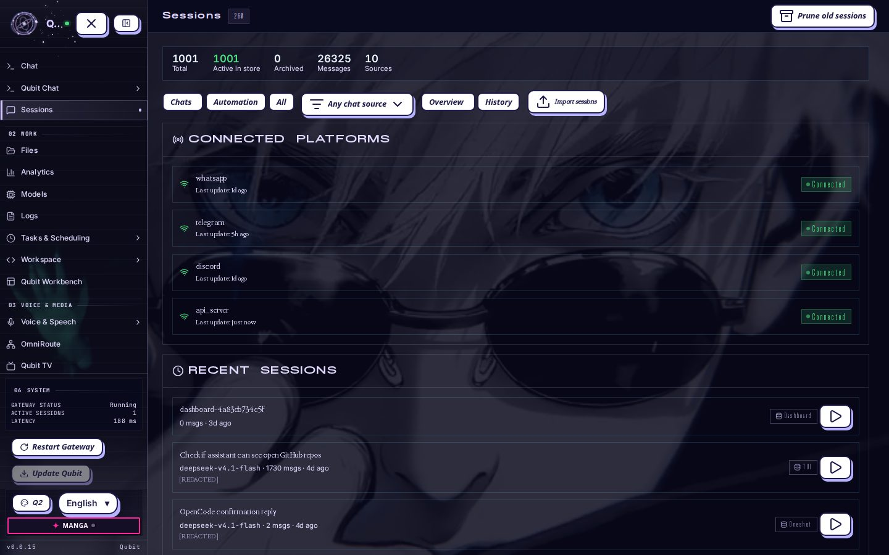
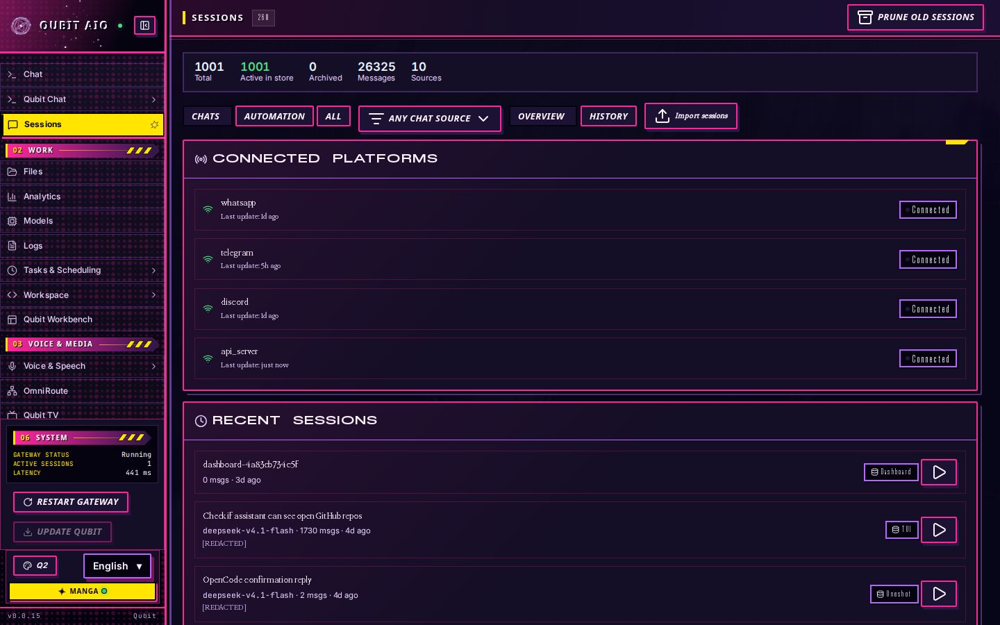
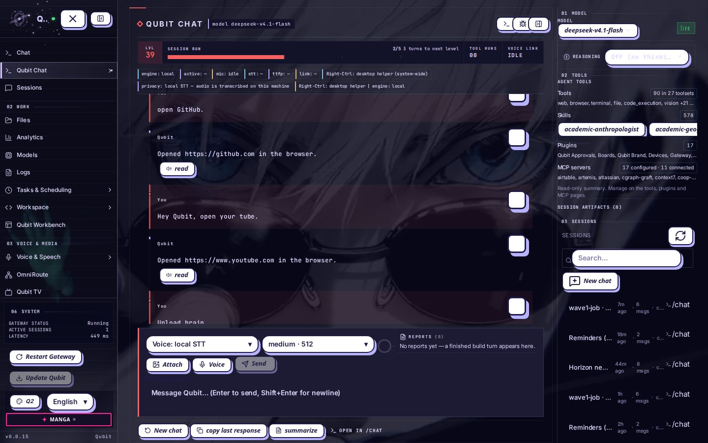
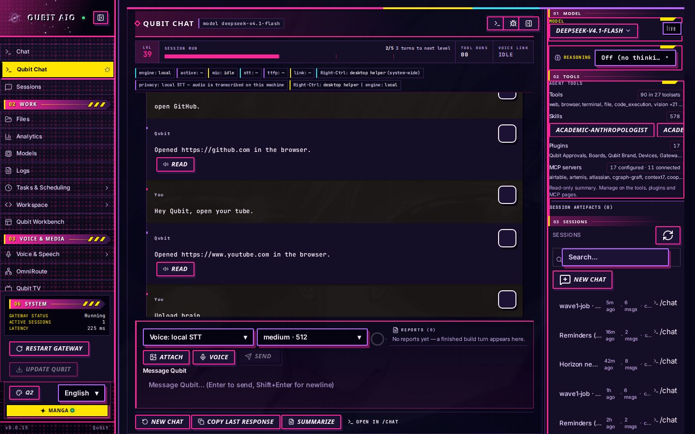

# Optional Manga Skin — Web Dashboard

**Status:** implemented, typechecked, tested and built on this branch. Opt-in and reversible.
The standalone MANGA button was removed at owner request; Q4/Q4-L in the Theme panel is the
only switch.
**Scope:** the main React web dashboard under `frontend/qubit-web` only.

Q4 is now a first-class theme in the dashboard Theme panel, with a Q4-L large variant. There is
no separate MANGA button: selecting Q4/Q4-L is the only way to turn the skin on. The old Q1 teal, Q1-L, Q5,
Q5-L and Qubit Command were removed at owner request. The surviving themes are presented in
normal order: Q1/Q1-L, Q2/Q2-L, Q3/Q3-L and Q4/Q4-L.

---

## Turn it on (exact steps)

1. Build/launch the web dashboard as usual (`cd frontend/qubit-web && npm run build`, or run the
   packaged dashboard).
2. Open the **Theme** panel from the palette button at the bottom of the left sidebar.
3. Select **Q4** (or **Q4-L** for the larger-type variation).
   - The theme button becomes the yellow manga badge (✦ + Q4/Q4-L + lamp).
   - The dashboard applies the manga skin immediately.
4. Keyboard: the theme trigger is a native button with a visible focus ring; `Tab` then
   `Enter`/`Space` opens the picker.
5. Mobile: open the sidebar with the menu button, then the Theme panel.

Q4/Q4-L are persisted like every other theme (server-side theme preference plus the local
theme cache), so the choice survives reloads. The skin is derived from the selected theme; there
is no second switch to keep in sync. Selecting any non-Q4 theme removes the skin.

### Q4 / Q4-L

| Theme | Behaviour |
|---|---|
| **Q4** | Manga skin with the dashboard's comfortable typography/density |
| **Q4-L** | The same palette/skin with larger type and roomier spacing (the standard Q-L treatment) |

The Theme panel row for Q4/Q4-L uses the yellow manga badge (star, yellow plate, ink text,
lamp). There is no standalone MANGA button any more.

---

## What the skin does

A single scoped layer (`html[data-qubit-manga="on"]`) recolours and reframes the existing
components; no component tree, route, API or state machine is replaced.

| Layer | What is styled |
|---|---|
| Shell | page headers, status bar, left rail (expanded + collapsed + mobile), section strips, utility/system/telemetry blocks, colophon |
| Chrome | cards, panels, plates, modals/dialogs, flyouts, popovers, tables, lists, tabs, segmented controls |
| Forms | text/number/date/time/select/textarea, checkboxes/radios/toggles/sliders, focus/disabled states |
| Chat | chat header, message bubbles, tool/progress messages, composer frame, right-hand model/tools/skills/sessions panel |
| Data | analytics cards and series tokens, table headers/rows, file browser and drop zone, sessions/profiles/agents rosters |
| Feedback | loading/progress, error alerts, success/status chips, toasts, tooltips |
| Sakuga | palette through the public `--sk-*` variables and `::part()` seams; effects/animations untouched |

Visual language: hot magenta frames, deep navy/black panel interiors, electric violet edges,
yellow impact accents, angular/notched headers, halftone corners, and comic-spine labels.
Ornaments are scalable SVG/CSS; every label, value and input remains live DOM text.

### Design tokens (CSS)

`manga.css` declares one palette and maps it onto the dashboard's existing seams:

- theme tokens (`--background-base`, `--midground-base`, `--color-*`, `--text-*`)
- Qubit plate ladder (`--qplate-*`)
- Sakuga's public control variables (`--sk-card`, `--sk-ink`, `--sk-pri`, `--sk-acc`, …)
- the Card primitive's documented variables (`--component-card-*`)

There are no hardcoded per-page colours and no background images carrying UI copy.

---

## Exclusions (verified)

The gate removes `data-qubit-manga` — and therefore every rule in `manga.css` — on:

- `/qubit-workbench` (server-served document; untouched)
- `/qubit-hud`
- `/qubit-office`, `/qubit-office2`, `/qubit-office3` and every descendant path

Verified with the skin preference ON: the marker is absent, the sidebar returns to the active
theme, and no Manga control is rendered on those routes. The Electron desktop app, Workbench,
HUD and the Office plugin bundles are not edited.

Navigation to an excluded route removes the marker in a **layout effect**, so the excluded
surface never paints one manga frame.

---

## Files

| File | Role |
|---|---|
| `src/manga-skin/manga-store.ts` | preference, route eligibility, external store, pre-paint bootstrap |
| `src/manga-skin/MangaSkin.tsx` | `MangaSkinGate` (document marker only; no separate button) |
| `src/manga-skin/manga.css` | the entire visual layer (gated by `html[data-qubit-manga="on"]`) |
| `src/main.tsx` | mounts the gate under the router; applies the persisted marker before first paint |
| `src/themes/presets.ts` | Q4 / Q4-L definitions and the `isMangaThemeName` helper |
| `src/themes/context.tsx` | keeps the skin in lockstep with theme selection; remembers the return theme |
| `src/components/ThemeSwitcher.tsx` | Q4/Q4-L rows and the yellow theme trigger |
| `qubit_runtime/qubit_cli/web_server_dashboard.py` | Q4/Q4-L in the served built-in theme list |
| `vite.config.ts` | dev-only token scrape so `npm run dev` against a live dashboard authenticates |
| `public/manga-ui/*.svg` | text-free ornaments: halftone, impact star, section slashes, panel corner |
| `src/manga-skin/manga-skin.test.tsx` | route gating, persistence, excluded routes, no separate switch |
| `src/manga-skin/manga-css.test.ts` | stylesheet scope, palette, seams, assets, xterm exclusion |

---

## Verification

Run from `frontend/qubit-web`:

```bash
npm ci
npm run typecheck        # exit 0
npm run test             # 173 files / 1366 tests passed
npm run build            # exit 0

# Python theme contract (from the repo root):
PYTHONPATH=qubit_runtime:. python -m pytest -q tests/test_parity_wave22_channels_themes9u.py   # 5 passed
```

Focused skin tests:

```bash
npx vitest run src/manga-skin   # 2 files / 14 tests passed
npx eslint src/manga-skin src/main.tsx   # exit 0 (0 errors)
```

Browser verification was run against the real dashboard APIs (a Vite dev server on `:5199`
proxying the live `:8890` backend, with the real session token). Checked at 1440×900,
390×844 and with the sidebar collapsed:

- skin marker present on every eligible route; absent on every excluded route
- no document-level horizontal overflow at either width
- no new console/page errors in the verified flows (the only expected message is the existing
  typed `403 MEMORY_LOCAL_ONLY` on `/plugins`)
- Q4/Q4-L selectable from the Theme panel; Q4-L applies the larger root type
- the theme trigger adopts the yellow Q4 badge while active
- the retired Q1-teal / Q1-L / Q5 / Q5-L / Qubit Command ids are absent from the picker and served list
- selecting Q1/Q2/Q3 removes the skin; Q4/Q4-L persist across reloads
- Q4 persists across reload even against a not-yet-restarted backend (the client keeps a
  client-known built-in and re-attempts to persist it; the served list includes Q4 after the
  backend update)
- dialogs, theme flyout, select panels, toasts, loading, error and disabled states exercised
- excluded Office/HUD surfaces render with their original theme and no marker

`npm run test` emits one benign jsdom/GSAP `cancelAnimationFrame` teardown warning when the whole
suite runs together; the originating test passes alone and no assertion fails. It is not caused
by this change.

Hosted GitHub Actions jobs on this repository currently fail before starting (1–4 s, zero steps,
no logs) because of the known account/billing startup block recorded in `docs/STATUS.md`; that is
infrastructure, not this branch. The repo-local blob-size gate also flags a pre-existing Habblaud
bundle already on the branch (`frontend/qubit-app/plugins/qubit-office/habblaud/bundle/app-D_Gc15aD.js`,
682 KiB). Every screenshot added here is under 200 KiB.

### Route coverage

Statuses:
- **Visual** — opened with the skin ON; screenshot reviewed; marker present, no document
  overflow, no console/page errors in the flow.
- **Smoke** — opened with the skin ON; screenshot captured; marker present, no document overflow,
  no console/page errors. Uses the same shared primitives as the Visual routes but was not
  individually design-reviewed in the final pass.
- **Partial** — shared chrome is themed; the named subsystem is deliberately not themed.
- **Excluded** — untouched by design.

| Family | Routes | Status |
|---|---|---|
| Root / chat | `/` → `/chat`, `/chat` | `/chat` **Partial** (xterm canvas), rest Visual |
| | `/qubit-chat`, `/webchat`, `/qubit-bot`, `/qubit-harness-router` | `/qubit-chat`, `/webchat` **Visual**; rest **Smoke** |
| Sessions & tasks | `/sessions`, `/qubit-tasks`, `/qubit-scheduler`, `/qubit-taskflows`, `/qubit-board-admin`, `/checkpoints` | **Visual** |
| | `/session-ops`, `/worktrees`, `/cron`, `/qubit-task-inbox` | **Smoke** |
| Files / analytics | `/files`, `/analytics`, `/operations` | `/files`, `/analytics` **Visual**; `/operations` **Visual/Partial** (ported inline body) |
| | `/logs`, `/reports` | **Smoke** |
| Models | `/models` | **Visual** |
| | `/qubit-models`, `/omniroute` | **Smoke** |
| Config / settings | `/config`, `/plugins`, `/skills`, `/mcp`, `/channels`, `/system`, `/admin/users` | **Visual** |
| | `/env`, `/webhooks`, `/pairing`, `/admin/skills-review`, `/admin/mcp-calls`, `/profiles/new`, `/docs` | **Smoke** |
| Profiles | `/profiles` | **Visual** |
| Agents / tools | `/agents`, `/agent-workspace` | **Visual** |
| | `/agent-cards`, `/computer`, `/canvas`, `/kitchen` | **Smoke** |
| Workspace / nodes | `/nodes`, `/devices` | **Smoke** |
| Voice | `/qubit-talk` | **Visual** |
| | `/voice-edit` | **Smoke** |
| Memory | `/qubit-memory`, `/memory` | **Smoke** |
| Open Viking | `/open-viking` | **Visual** |
| | `/open-viking/retrieval`, `/uploads`, `/agent-hub`, `/resources`, `/context-store` | **Smoke** |
| Media / misc | `/qubit-tv`, `/guide` | **Visual** |
| | `/sakuga-gallery`, `/achievements`, `/qubit-boards`, `/qubit-runtime`, `/qubit-gateway`, `/qubit-approvals` | **Smoke** |
| Excluded | `/qubit-workbench`, `/qubit-hud`, `/qubit-office`, `/qubit-office2`, `/qubit-office3` | **Excluded** |

### Known limitations

- **Terminal content:** `/chat` embeds the real Ink TUI in xterm; its canvas content keeps the
  terminal's own colours. The surrounding panels/composer chrome is themed.
- **Sakuga toggle art:** the 108×54 toggle is a pre-rendered sprite sheet; recolouring it would
  mean editing the vendored asset, which this change deliberately does not do. It keeps the
  upstream lavender look as the one non-palette control.
- **Third-party embedded surfaces:** OpenViking's embedded studio and other iframe/embedded
  tools keep their own styling; only the Qubit host chrome around them is themed.
- **No calendar route:** this dashboard build has no dedicated calendar component; the scheduler
  forms are themed instead.
- **Dev-server quirk (not a product bug):** Vite's `/agent` proxy prefix also captures `/agents`
  and `/agent-workspace` on direct URL loads in development. They were verified through
  client-side navigation. A production dashboard build is unaffected.
- **Email/Webhooks/etc.:** they use the same settings primitives and inherit the skin, but each
  was not individually screenshotted in the final pass.

---

## Screenshot gallery

Captured from the real dashboard at 1440×900 (mobile 390×844) with the real backend. Files live
in [`docs/manga-skin/`](../../docs/manga-skin/).

| Before (OFF) | After (ON) |
|---|---|
|  |  |
|  |  |

More: `manga_config.jpg`, `manga_models.jpg`,
`manga_plugins.jpg`, `manga_tasks.jpg`,
`manga_analytics.jpg`, `manga_system.jpg`, `manga_dialog_model_picker.jpg`,
`manga_sidebar_collapsed.jpg`, `manga_mobile_sessions.jpg`, `manga_mobile_chat.jpg`,
`excluded_hud_unchanged.jpg`, `excluded_office_unchanged.jpg`.

---

## Rollback

No data or backend state is involved. Click **MANGA** to turn it off, or run in the browser
console:

```js
localStorage.setItem("qubit-manga-skin-enabled", "false");
location.reload();
```

Deleting the `src/manga-skin/`, `public/manga-ui/` folders and the two `main.tsx` lines removes
the feature completely.
